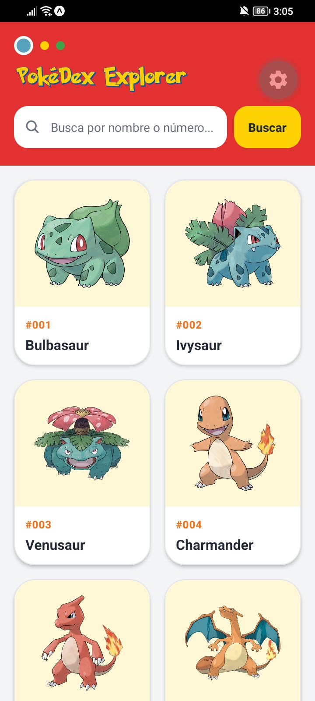
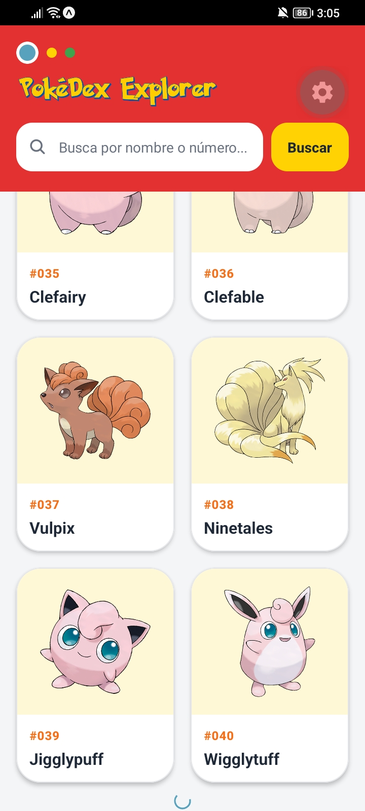
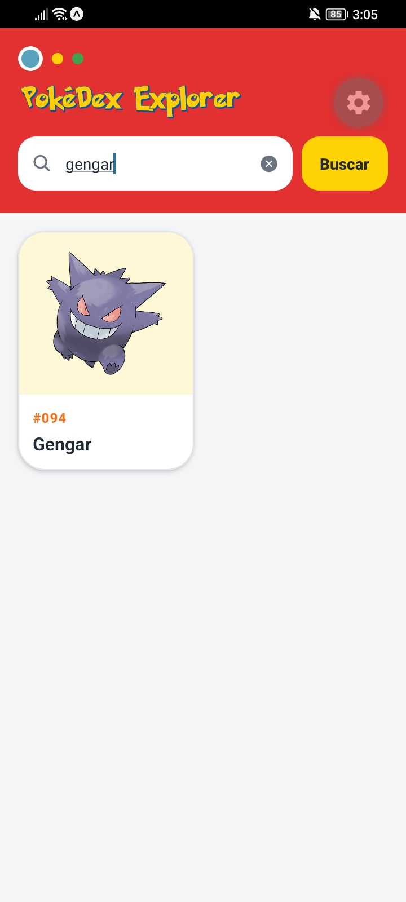
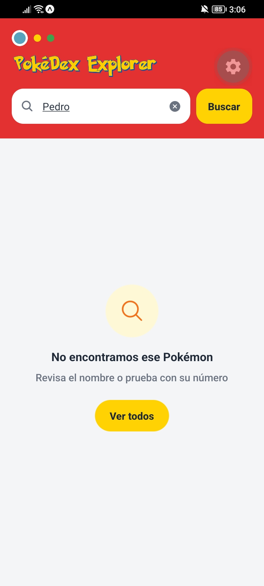
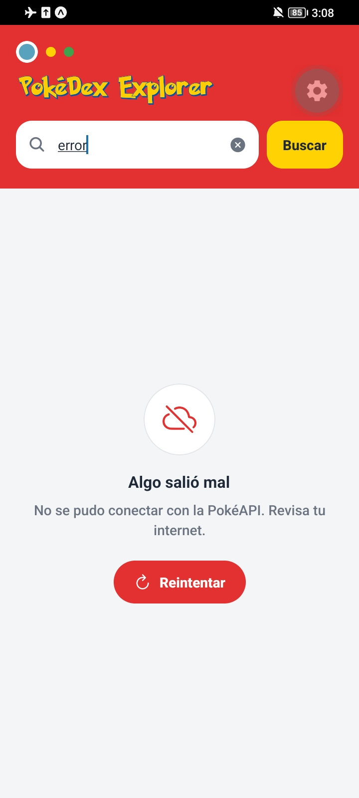
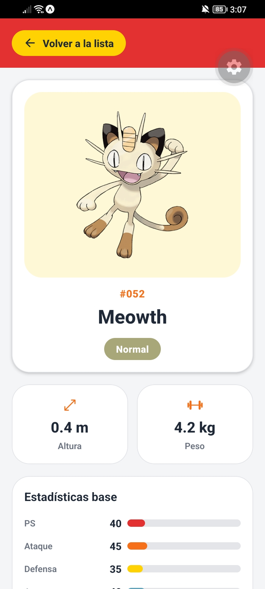
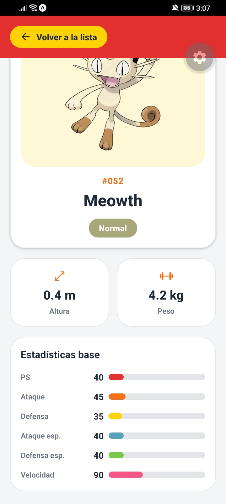
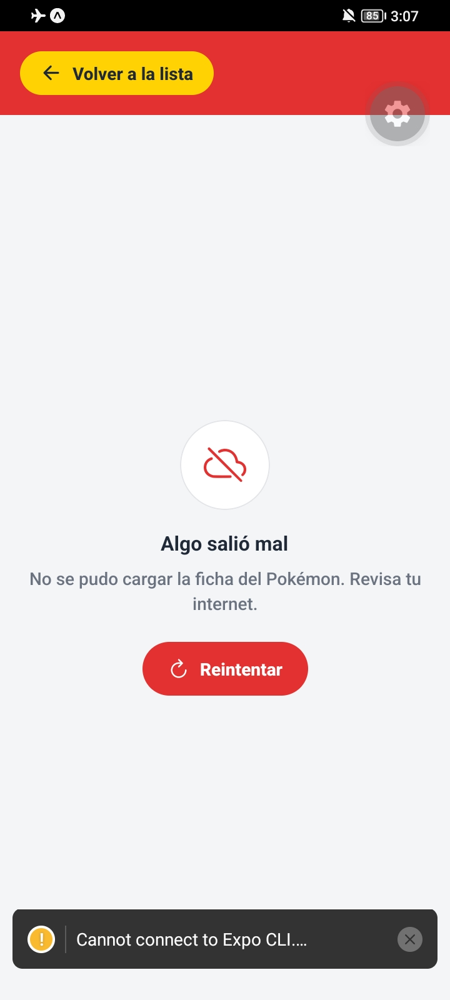

# PokéDex Explorer

App móvil hecha con **React Native**, **Expo** y **JavaScript** que consume la [PokéAPI](https://pokeapi.co/). Muestra una lista de Pokémon con scroll infinito, permite buscarlos por nombre o número y abre una ficha con su imagen, tipos, medidas y estadísticas base.

**Autor:** _(escribe aquí tu nombre)_
**Taller:** Consumo de API con React Native y Expo

---

## ¿Qué hace la app?

**Vista de lista**
- Encabezado con el logo de PokéDex Explorer.
- Barra de búsqueda con botón "Buscar". Acepta nombre o número e ignora mayúsculas y espacios al inicio o al final.
- Cuadrícula de 2 columnas con tarjetas: imagen, número con 3 dígitos (`#025`) y nombre con la primera letra en mayúscula.
- Al abrir la app carga 20 Pokémon, y al llegar al final de la lista carga 20 más (scroll infinito) mostrando un indicador de carga.
- Al tocar una tarjeta se abre la ficha de ese Pokémon.

**Vista de detalle**
- Imagen grande, nombre y número.
- Un distintivo por cada tipo, con un color propio por tipo.
- Altura en metros y peso en kilogramos.
- Las 6 estadísticas base, cada una con su valor y una barra de ancho proporcional (máximo 255).
- Botón "Volver a la lista".

**Estados de la interfaz**

| Estado | Qué ve el usuario |
|---|---|
| Cargando | Indicador de carga con texto |
| Error | Mensaje en español y botón "Reintentar" |
| Sin resultados | Mensaje cuando el Pokémon buscado no existe |
| Éxito | La lista o la ficha |

---

## Cómo correr el proyecto

```bash
npm install
npx expo start
```

Escanea el QR con Expo Go, o presiona `i` (simulador iOS) o `a` (emulador Android).

**Librerías usadas**

| Librería | Para qué se usa |
|---|---|
| `expo` y `react-native` | Base del proyecto |
| `react-native-safe-area-context` | Respetar la zona segura (notch y barra de estado) |
| `@expo/vector-icons` | Íconos (lupa, flechas, estados). Viene incluida con Expo |

No se instaló ninguna librería HTTP porque `fetch` ya viene incluido en React Native. Tampoco se usó ninguna librería de navegación, base de datos ni manejo de estado global.

---

## Arquitectura del proyecto

### Árbol de carpetas

```
App.js
assets/
└── pokedex-explorer-logo.png
src/
├── api/
│   └── pokemonApi.js
├── screens/
│   ├── HomeScreen.js
│   └── DetailScreen.js
├── components/
│   ├── PokemonCard.js
│   ├── TypeBadge.js
│   ├── StatBar.js
│   ├── LoadingState.js
│   ├── ErrorState.js
│   └── EmptyState.js
├── theme/
│   └── index.js
└── utils/
    └── formatters.js
```

### Idea general

Organicé el proyecto en capas y cada capa tiene un solo trabajo. La regla del taller que más tuve en cuenta fue que **las llamadas a la API no deben quedar mezcladas con los estilos y el JSX de cada componente**. El flujo de los datos va siempre en un solo sentido:

```
PokéAPI  →  api/  →  screens/  →  components/
(internet)  (pide y   (guardan     (solo dibujan
             limpia)   los estados)  lo que reciben)
```

### Responsabilidad de cada archivo

**`App.js`**
Es el punto de entrada. Envuelve todo en `SafeAreaProvider` y decide qué vista se muestra. Guarda con `useState` el id del Pokémon seleccionado: si es `null` muestra `HomeScreen`, y si tiene un id muestra `DetailScreen`. Así la app tiene una pantalla principal con dos vistas, sin librerías de navegación.

**`src/api/pokemonApi.js`**
Es el **único archivo que usa `fetch`**. Tiene dos funciones:
- `fetchPokemonList(limit, offset, signal)`: trae una página de la lista y avisa si hay más (`hasMore`).
- `fetchPokemonDetail(nameOrId, signal)`: trae la ficha de un Pokémon por nombre o número.

Ambas usan `async/await`, revisan `response.ok` **antes** de llamar a `response.json()` (porque un nombre inexistente responde 404 con texto plano, no JSON) y transforman la respuesta con funciones `map...` para quedarse solo con los campos que usa la app. Los errores guardan el código HTTP en `error.status`, para distinguir un 404 de un fallo de red.

**`src/screens/HomeScreen.js`**
Pantalla de la lista. Maneja la búsqueda, la carga inicial, el scroll infinito y los estados de carga, error y vacío. Usa una `FlatList` de 2 columnas con `keyExtractor`, `onEndReached` y un indicador al final (`ListFooterComponent`). Separa `searchText` (lo que el usuario escribe) de `query` (lo que realmente se busca), para que la petición se haga solo al presionar "Buscar" y no con cada letra.

**`src/screens/DetailScreen.js`**
Pantalla de la ficha. Recibe el id del Pokémon, lo pide a la API con un `useEffect` y muestra la imagen, los tipos, la altura, el peso y las estadísticas. El botón "Volver a la lista" está siempre visible, aunque la ficha esté cargando o haya fallado.

**`src/components/`**
Son piezas pequeñas que no hacen peticiones: reciben todo por `props`.

| Componente | Qué dibuja |
|---|---|
| `PokemonCard` | La tarjeta de la lista (imagen, número y nombre) |
| `TypeBadge` | El distintivo de un tipo, con su color y su nombre en español |
| `StatBar` | Una estadística con su valor y una barra proporcional al máximo de 255 |
| `LoadingState` | Indicador de carga con texto |
| `ErrorState` | Mensaje de error y botón "Reintentar" |
| `EmptyState` | Mensaje de "sin resultados" y un botón para limpiar la búsqueda |

**`src/theme/index.js`**
Guarda los colores (rojo, amarillo, azul y naranja de la Pokédex), el espaciado, los radios de borde, la tipografía, las sombras, la paleta de colores por tipo y los colores de las estadísticas. Así los estilos no tienen valores sueltos y cualquier cambio de diseño se hace en un solo lugar.

**`src/utils/formatters.js`**
Funciones pequeñas que se usan en varios archivos:
- `getIdFromUrl(url)`: saca el id del final de la URL, porque la lista solo trae nombre y URL.
- `getImageUrl(id)`: arma la URL de la imagen para la lista sin pedir la ficha completa.
- `padId(id)`: convierte `25` en `025` con `String(id).padStart(3, '0')`.
- `capitalize(text)`: pone la primera letra en mayúscula.

---

## ¿Por qué lo organicé así?

1. **Separé la red de la interfaz.** Si `fetch` estuviera dentro de las pantallas, cada archivo mezclaría peticiones, estados, JSX y estilos. Con `api/` aislada, si cambia la URL o la forma de pedir los datos, solo toco un archivo, y las pantallas no saben cómo se piden los datos, solo llaman a una función.
2. **Los componentes solo dibujan.** `PokemonCard`, `TypeBadge` y `StatBar` reciben datos por props y no saben de dónde vienen. Por eso son reutilizables: `StatBar` se usa 6 veces en la ficha y `TypeBadge` una vez por cada tipo.
3. **Los estados de la interfaz son componentes propios.** `LoadingState`, `ErrorState` y `EmptyState` se usan tanto en la lista como en el detalle, así que no repetí código.
4. **No usé hooks personalizados ni Context.** La lógica de cada pantalla es corta y cada una usa sus propios estados. El único dato compartido entre pantallas es el Pokémon seleccionado, y viaja por props desde `App.js`. Un Context para un solo dato habría sido más complejidad de la necesaria.
5. **No usé librerías de navegación.** El taller describe una pantalla principal con dos vistas, así que un `useState` en `App.js` es suficiente y no depende de librerías extra.
6. **No usé base de datos.** Todos los datos vienen de la PokéAPI y la app no guarda nada.
7. **Es fácil de depurar.** Si algo falla sé en qué capa buscar: si los datos llegan mal, miro `api/`; si el estado no cambia, miro la pantalla; si algo se ve mal, miro el componente o el tema.

---

## Conceptos del taller y dónde se usan

Cada concepto está marcado en el código con un comentario `// CONCEPT:`.

| Concepto | Dónde se ve |
|---|---|
| Consumo de API con `fetch` y `async/await` | `src/api/pokemonApi.js` |
| Revisar `response.ok` antes de `response.json()` | `src/api/pokemonApi.js` |
| Array de dependencias de `useEffect` | `HomeScreen.js` y `DetailScreen.js` |
| Cancelar peticiones con `AbortController` | `HomeScreen.js` y `DetailScreen.js` |
| `FlatList` con `numColumns`, `keyExtractor` y `onEndReached` | `HomeScreen.js` |
| Scroll infinito con indicador al final | `HomeScreen.js` |
| `Image` con URL remota (con `width` y `height`) | `PokemonCard.js` y `DetailScreen.js` |
| Estados: cargando, error, vacío y éxito | `LoadingState`, `ErrorState`, `EmptyState` y las pantallas |
| `useState` para alternar entre vistas | `App.js` |

---

## Capturas de pantalla

### 1. Lista inicial


### 2. Scroll infinito (cargando más)


### 3. Búsqueda con resultado


### 4. Sin resultados


### 5. Estado de carga


### 6. Estado de error en la lista


### 7. Ficha de detalle (imagen, tipos, altura y peso)


### 8. Ficha de detalle (estadísticas)


### 9. Estado de error en el detalle
